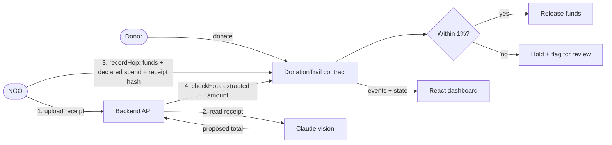

<div align="center">

# Follow Your Dollar

**Every donated dollar, traced to a receipt.**

A public on-chain trail for donations. AI reads the receipt, a smart contract decides whether it matches, and funds are released only when it does.


[Architecture](docs/ARCHITECTURE.md) · [Demo script](docs/DEMO_SCRIPT.md) · [Submission text](docs/SUBMISSION.md)

</div>

---

## The problem

Donors give to charities and relief funds, then see very little of what happens next. Reports arrive late, are summarized, and are controlled by the organization that wrote them. When trust breaks, people stop giving.

## The solution

Follow Your Dollar puts every hop of a donation on a public trail, with a receipt behind each payment.

1. **Donate.** Donors fund an NGO campaign.
2. **Pay onward.** The NGO pays a vendor or field office and attaches a receipt. The funds are **held in escrow** by the contract.
3. **Read.** An AI model reads the receipt total. It only *proposes* a number.
4. **Decide.** The contract compares it with the declared spend, in plain code, on-chain.
   - **Match (within 1%)** → funds are released automatically.
   - **Mismatch** → funds stay held and the hop is flagged for a human reviewer, who approves it or returns the money to the campaign.
5. **Follow.** A dashboard draws the trail as a live map. Released money flows, held money is dotted, flagged hops are red.

> **AI proposes; deterministic code and the chain prove.** No model decides whether a hop is valid. The chain proves a record was not altered. It cannot prove a receipt is genuine, which is why mismatches go to human review.

## How it works



Hop statuses: `Pending` (in escrow) · `Verified` (released) · `Flagged` (held for review) · `Approved` (reviewer released) · `Rejected` (returned to the campaign).

Full detail in [docs/ARCHITECTURE.md](docs/ARCHITECTURE.md).

## Repository layout

| Path | Contents |
|---|---|
| `contracts/` | Foundry project: `DonationTrail.sol`, 25 tests, deploy script |
| `backend/` | Express API in TypeScript: receipt upload, AI extraction, on-chain check |
| `frontend/` | Next.js (React, TypeScript) dashboard with the trail map |
| `shared/` | Contract ABI used by both apps |
| `scripts/` | One-command local demo |
| `docs/` | Architecture, demo script, submission text |

## Quick start

**Prerequisites:** [Foundry](https://book.getfoundry.sh/getting-started/installation), Node.js 20+.

```bash
# one-time: contract test library, then dependencies
(cd contracts && forge install foundry-rs/forge-std --no-git)
(cd backend && npm install)
(cd frontend && npm install)

# anvil + deploy + backend (mock AI) + seeded data + frontend on http://localhost:5173
bash scripts/demo-local.sh
```

The script uses anvil's public test keys and never touches your own `.env` files. It prints the network settings and the test key to import into your wallet.

## Run step by step

```bash
# 1. Chain and contract
anvil                                          # terminal 1
cd contracts && forge test
VERIFIER_ADDRESS=<verifier address> forge script script/Deploy.s.sol \
  --rpc-url http://127.0.0.1:8545 --broadcast --private-key <anvil key>

# 2. Backend  (copy .env.example to .env first)
cd backend && npm start                        # http://localhost:8787

# 3. Frontend (copy .env.example to .env.local first)
cd frontend && npm run dev                     # http://localhost:3000
```

With no `ANTHROPIC_API_KEY`, the backend runs in **mock mode**: the uploader types the receipt total and results are labelled `source: "mock"`. Set the key for real extraction.

## Configuration

**Backend (`backend/.env`)**

| Variable | Purpose |
|---|---|
| `PORT` | API port (default `8787`) |
| `FRONTEND_ORIGIN` | Comma-separated origins allowed by CORS |
| `CHAIN` | `local` or `baseSepolia` |
| `RPC_URL` | Optional RPC override |
| `CONTRACT_ADDRESS` | Deployed `DonationTrail` address |
| `VERIFIER_PRIVATE_KEY` | Verifier wallet key (throwaway, testnet only) |
| `ANTHROPIC_API_KEY` | Enables real AI extraction; empty means mock mode |
| `ANTHROPIC_MODEL` | Model used for extraction |

**Frontend (`frontend/.env.local`)**: `NEXT_PUBLIC_CHAIN`, `NEXT_PUBLIC_RPC_URL`, `NEXT_PUBLIC_CONTRACT_ADDRESS`, `NEXT_PUBLIC_API_URL`. Only public values belong here.

## Smart contract

| Function | Caller | Effect |
|---|---|---|
| `createCampaign(name)` | NGO | Creates a campaign owned by the caller |
| `donate(campaignId)` | Anyone | Adds test ETH to the campaign balance |
| `recordHop(...)` | Campaign NGO | Moves funds into escrow for a hop; stores declared spend and receipt hash |
| `checkHop(hopId, extractedCents)` | Verifier | Runs the match rule once: match releases, mismatch holds |
| `reviewHop(hopId, approve)` | Verifier (reviewer) | Resolves a flagged hop: release or return to the campaign |
| `reclaim(hopId)` | Campaign NGO | After 7 days, pulls back funds from an unresolved hop |

Safeguards: owner-only spending, verifier-only checks, one check per hop, hops cannot exceed the campaign balance, state is updated before any ETH transfer, and a recipient that refuses payment cannot block the process.

## Deploy to Base Sepolia

1. Create a throwaway wallet and fund it with test ETH from a faucet. Never use a wallet that holds real funds.
2. Create a second throwaway wallet to act as the verifier.
3. Deploy with `forge script ... --rpc-url <Base Sepolia RPC>` and set `CHAIN=baseSepolia` and `NEXT_PUBLIC_CHAIN=baseSepolia`.
4. Keep private keys in git-ignored `.env` files only, never in code or chat.

## Testing

| Suite | Command | Coverage |
|---|---|---|
| Contracts | `cd contracts && forge test` | 25 tests: access control, escrow accounting, match rule, review, reclaim |
| Backend | `cd backend && npm test` | 6 tests: extraction, schema validation, upload types |
| Types | `npm run typecheck` in `backend/` and `frontend/` | Strict TypeScript, no emit |
| End to end | `bash scripts/demo-local.sh` | Local chain with one Verified and one Flagged hop |

Real AI extraction has not been tested against the live API yet; it needs an API key.

## Security notes

- No keys in code; secrets are read from git-ignored `.env` files.
- Uploads are limited to 5 MB and to JPEG, PNG, WebP, GIF or PDF.
- The check endpoint accepts only an extraction whose hash equals the receipt hash stored on-chain for that hop, so one receipt cannot be substituted for another.
- CORS is restricted to configured frontend origins.

## Known limitations

- The chain proves a record is unchanged, not that a receipt is genuine. Flagged hops go to human review.
- A single verifier address submits checks and reviews flagged hops. A production version would use a reviewer quorum.
- Declared spend and receipt total are compared as plain numbers in one currency.
- Uploaded receipts are held in backend memory only; the chain stores just the hash.
- Unresolved hops can be reclaimed by the NGO after 7 days.
- Prototype on a testnet, not audited. Do not use with real funds.

## Roadmap

- Reviewer quorum and a public on-chain review record
- Currency-aware comparison with an oracle for exchange rates
- Receipt storage on decentralized storage, with only the hash on-chain
- Independent security audit

## Tech stack

Solidity 0.8 · Foundry · TypeScript · Node.js · Express · viem · zod · Claude (vision) · Next.js · React · Base Sepolia
