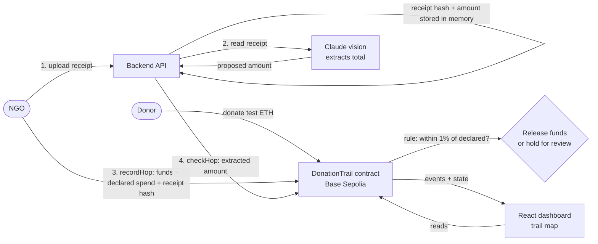

# Technical Architecture

## Principle

**AI proposes, deterministic code and the chain prove.** The AI model only reads a receipt and suggests an amount. The match rule is plain code running in a smart contract, and the result is stored on a public chain. No model decides whether a hop is valid.

## Components

| Component | Tech | Responsibility |
|---|---|---|
| Smart contract | Solidity 0.8, Foundry | Campaigns, donations, hops, receipt hash, on-chain match rule, status |
| Backend | Node, Express, viem, zod | Receipt upload, AI extraction, submits `checkHop` as the verifier |
| AI step | Claude (vision) | Proposes the receipt total as schema-validated JSON |
| Frontend | Next.js (React), viem | Trail map, receipts table, donate and send-onward forms |
| Chain | Base Sepolia (EVM testnet) | Public, tamper-evident record |

## Flow of one hop

1. The NGO uploads a receipt to the backend. The backend hashes the file (keccak256), asks the AI for the total, validates the answer against a schema, and keeps `hash -> extraction` in memory.
2. The NGO calls `recordHop(campaignId, to, amount, declaredCents, receiptHash, label)`. The funds are **held in escrow inside the contract** and the hop is stored as **Pending**. The recipient is not paid yet.
3. The backend reads the hop's receipt hash **from the chain**, looks up the extraction for that exact hash, and calls `checkHop(hopId, extractedCents)` from the verifier wallet.
4. The contract compares declared and extracted amounts. Within the tolerance (1%) the hop becomes **Verified** and the contract **releases the funds**. Otherwise it becomes **Flagged** and the funds **stay held**.
5. A reviewer resolves a flagged hop with `reviewHop(hopId, approve)`: **Approved** releases the funds, **Rejected** returns them to the campaign. If nobody resolves a hop for 7 days, the NGO can `reclaim` the funds.
6. The dashboard reads the chain and draws the trail. Animated lines mean money was released, dotted lines mean it is held, and flagged hops are red.

Hop statuses: `Pending` (in escrow), `Verified` (released), `Flagged` (held for review), `Approved` (reviewer released), `Rejected` (returned to the campaign).

## Smart contract (`contracts/src/DonationTrail.sol`)

| Function | Who | What |
|---|---|---|
| `createCampaign(name)` | NGO | Creates a campaign owned by the caller |
| `donate(campaignId)` | Anyone | Adds test ETH to the campaign balance |
| `recordHop(...)` | Campaign NGO only | Commits funds to a hop and holds them in escrow; stores declared spend and receipt hash |
| `checkHop(hopId, extractedCents)` | Verifier only | Runs the match rule once per hop: match releases funds, mismatch holds them |
| `reviewHop(hopId, approve)` | Verifier (reviewer) only | Resolves a flagged hop: release the funds or return them to the campaign |
| `reclaim(hopId)` | Campaign NGO only | After 7 days, pulls funds back from a hop that is still pending or flagged |
| `getCampaignHops(id)` | View | Hop ids in order |

Safeguards: only the campaign owner can commit funds, only the verifier can check or review, a hop can be checked once, a hop cannot exceed the campaign balance, state is updated before any ETH transfer, and a recipient that refuses payment cannot block the process (the hop is flagged and the reviewer can return the funds). 25 Foundry tests cover these paths, including the accounting between the contract balance, campaign balance and escrowed funds.

## Trust model and limits (stated openly)

| Limit | Mitigation / next step |
|---|---|
| The chain proves the record is unchanged, not that a receipt is genuine | AI check + rule check + human review of flagged hops; production would add reviewer quorum |
| One verifier address is trusted to submit checks and review flagged hops | Multiple verifiers or reviewer quorum; oracle network |
| The reviewer wallet could be wrong or compromised | Quorum of independent reviewers; public review record on-chain |
| Declared spend and receipt total are compared as plain numbers in one currency | Currency-aware comparison with an oracle for rates |
| Receipt files are not stored on-chain or persisted by the backend | Store files on decentralized storage and keep only the hash on-chain |
| Prototype, testnet only, not audited | Audit before any real funds |

## Security notes

- No private keys or API keys in code. They are read from git-ignored `.env` files.
- Uploads are limited to 5 MB and to JPEG, PNG, WebP, GIF or PDF.
- The check endpoint only accepts an extraction whose hash equals the receipt hash stored on-chain for that hop, so one receipt cannot be substituted for another.
- CORS is restricted to configured frontend origins.

## Testing

- `forge test` in `contracts/`: 25 tests.
- `npm test` in `backend/`: 6 tests (extraction, schema, upload types).
- End-to-end on a local chain through `scripts/demo-local.sh`, including a Verified and a Flagged hop.
- Real AI extraction has not been tested yet: it needs an API key.
